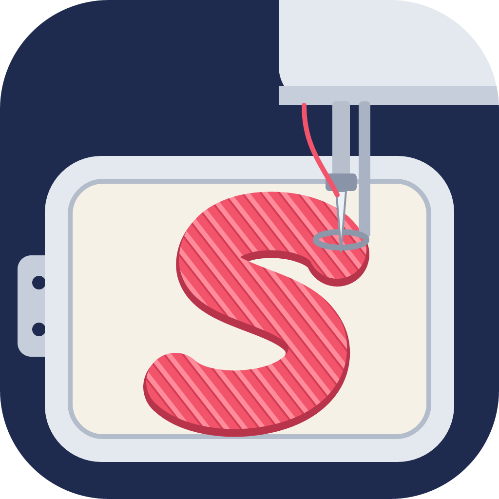
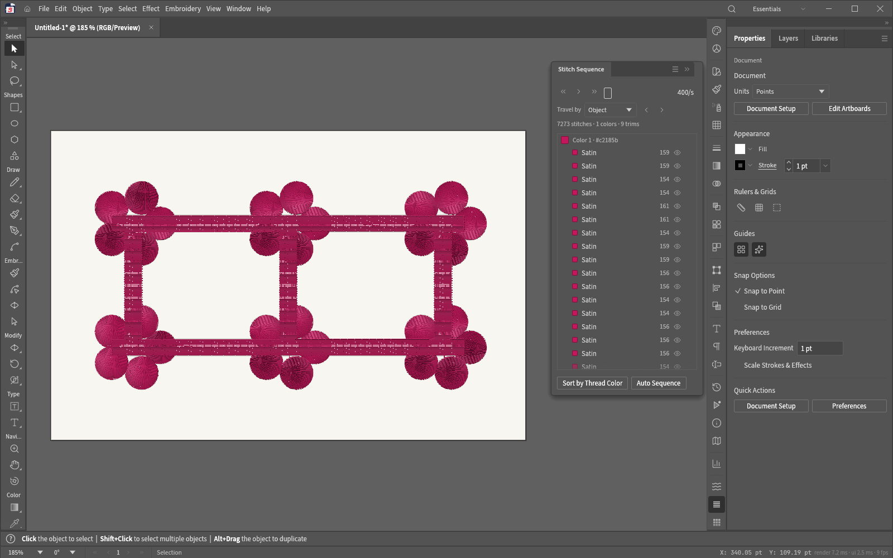

<p align="center">
  
</p>

<h1 align="center">StitchFoundry</h1>

<p align="center">
  <b>Open-source machine-embroidery digitizing, by SiteSentrix.</b>
</p>

<p align="center">
  Turn shapes, type and images into stitches, and write the files your embroidery machine reads.
  It runs natively on macOS, Windows, Linux and FreeBSD, and in the browser, and is written in pure
  Rust on top of the VectorCraft vector editor.
</p>

<p align="center">
  <a href="https://github.com/SiteSentrix/StitchFoundry/actions/workflows/ci.yml"></a>
  
  
  
  
  
</p>

> [!NOTE]
> **Pre-release.** Every machine format round-trips in software, and files StitchFoundry writes are
> read correctly by an independent open-source embroidery library, but nothing has been sewn on a
> real machine yet: test-sew before production runs. There are no release builds yet; build it
> from source (below).

<p align="center">
  
  <br><sub>Branching: thirty satin petals and a fill vine sewn as one thread, ordered in the Stitch Sequence panel</sub>
</p>

## What it does

- **Stitch types on anything you draw.** Any path, shape or type can carry running stitches
  (single, triple, bean, motif), satin and satin columns, tatami and other fills, or appliqué. Edit
  the shape and the stitches follow.
- **Direction placed for you, then yours to change.** Stitch angles are chosen automatically and
  stay editable on the canvas with inclination lines and start and stop beads.
- **Digitizing tools.** Column A/B digitizing, a radial digitizing widget with satin brushes,
  lettering from any font, and Auto-Digitize for flat-colour images.
- **Stitch-level control.** Edit single stitches and machine functions, split objects, branch
  objects into one thread run, sequence automatically, and keep objects alike with styles.
- **Design checks** for dense areas, long stitches and lettering too small to sew, machine
  profiles for each format, a hoop list, fabrics, thread charts and a stitch player.
- **Machine files:** DST, PES and PEC, JEF, EXP, VP3, XXX and U01, to open and to export.

[`docs/embroidery.md`](docs/embroidery.md) covers it all as you use it.

## Built on VectorCraft

StitchFoundry includes the full [VectorCraft](https://github.com/storytold/vectorcraft) editor: pen,
shape and brush tools, Pathfinder, type, gradients, live effects and artboards, and SVG, PDF, EPS,
DXF, EMF and raster files. Every action is an engine command, so agents can drive the app over a
JSON control channel and an MCP server the way a person does.

## Free and open source

StitchFoundry is free and open source. Paid cloud AI features (a design from a prompt, a logo
turned into stitches) are planned as optional credits; with your own AI keys they will be free
too.

## Build and run

Rust 1.97 or newer.

```sh
cargo run --release -p vectorcraft                          # the app (the program is stitchfoundry)
cargo run --release -p vectorcraft -- --control 7979        # + JSON control channel
cargo run --release -p vectorcraft-cli -- mcp               # MCP server (stdio)
cargo xtask ci                                              # fmt, clippy, tests, layering, wasm, vendor names
```

Japanese fonts come from the optional craft-fonts build input
(`CRAFT_FONTS_DIR="$PWD/../craft-fonts"`); without it, Japanese text uses the system fonts. See
[`docs/development.md`](docs/development.md) for graphics processors, Wayland and other platform notes.

## Docs

- [`docs/embroidery.md`](docs/embroidery.md): embroidery, as you use it
- [`docs/stitchfoundry-spec.md`](docs/stitchfoundry-spec.md): the build spec (architecture, feature
  matrix, roadmap, decisions)
- [`docs/mcp.md`](docs/mcp.md) and [`docs/control-protocol.md`](docs/control-protocol.md): driving it
  from agents
- [`AGENTS.md`](AGENTS.md): rules for contributors (clean-room, assets, no panics, quality gates)

StitchFoundry is written clean-room: behaviour comes from public documentation only, never from
commercial embroidery software.

## License and credits

StitchFoundry is dual-licensed under [MIT](LICENSE-MIT) or [Apache-2.0](LICENSE-APACHE), at your option.

Copyright (c) 2026 SiteSentrix and the StitchFoundry contributors.<br>
Copyright (c) 2026 ArtCraft Team and the VectorCraft contributors.

Required notices are in [NOTICE](NOTICE). Bundled fonts, icons, images and other assets keep their
own open licences; each one is listed with its author, source and licence in [ASSETS.md](ASSETS.md).
The app icon is original artwork; its files are in [`assets/app-icon/`](assets/app-icon/README.md).

StitchFoundry is based on [VectorCraft](https://github.com/storytold/vectorcraft) by the ArtCraft team.
It is an independent project, not made, sponsored or endorsed by the ArtCraft team.

<sub>Tajima, Brother, Janome, Melco, Pfaff, Husqvarna Viking, Singer and Barudan are trademarks of their
owners, named only to identify the file formats and hoops StitchFoundry works with. Adobe and Illustrator are
trademarks of Adobe Inc.; StitchFoundry is not affiliated with Adobe.</sub>
